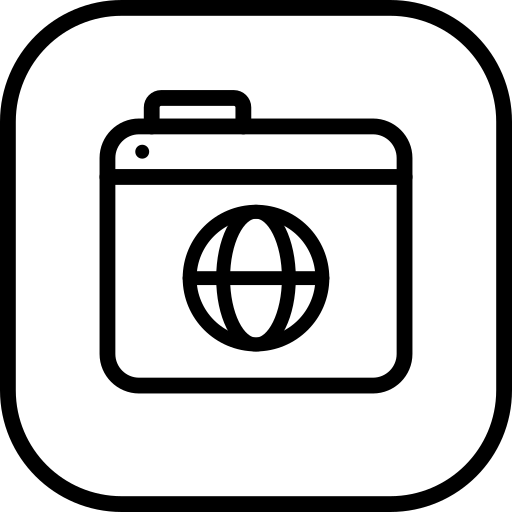
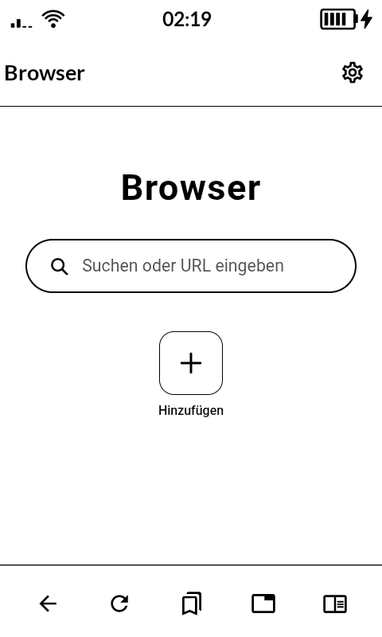
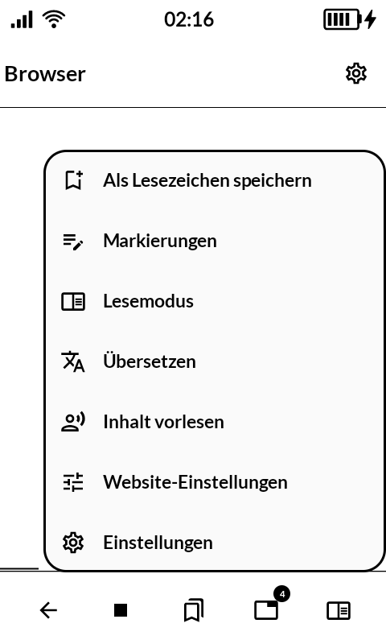
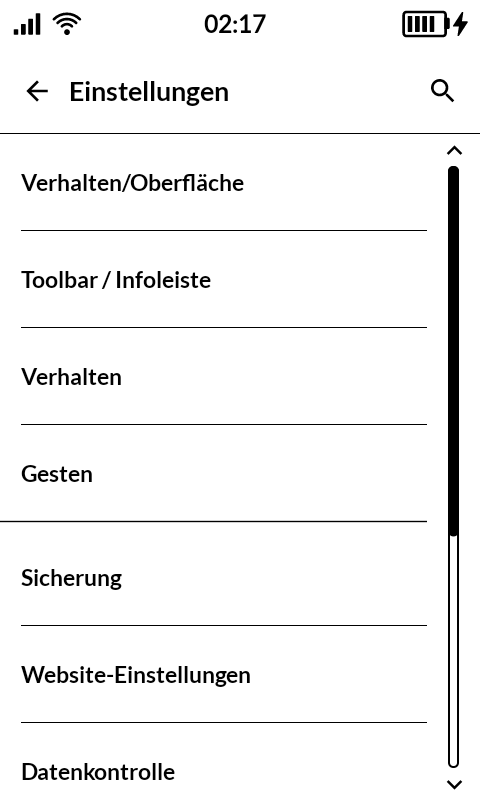

# 閲覧 etsuran — Browser

A web browser for the [Mudita Kompakt](https://mudita.com/products/kompakt/), built for its
e-ink screen and for reading rather than scrolling. It opens ordinary web pages, turns them
into clean reader text, keeps articles for later, and gets out of the way.

*Etsuran* is 閲覧 — reading, viewing, browsing. It is the everyday word for what one does
with a web page, and it names the act rather than the software. The app is called **Browser**
in English and German, and 閲覧 in Japanese.


| | |
|---|---|
|  |  |
|  | |

It is a fork of [EinkBro](https://github.com/plateaukao/einkbro) by Daniel Kao, which in turn
grew out of [FOSS Browser](https://codeberg.org/Gaukler_Faun/FOSS_Browser). All of the reading
tools come from there; the phone-store builds, the self-updater, and the colour-heavy chrome
do not.

## What it does

- **Reads the web without the noise.** Reader mode, article lists, text-only view, and a
  built-in “save for later” shelf.
- **Turns pages the way the Kompakt expects.** Tap zones, volume keys, and optional touch
  areas, with no page animations.
- **Keeps what you find.** Bookmarks, highlights, saved pages, EPUB/PDF export, and
  Instapaper.
- **Speaks it aloud.** System TTS or ReadAloud, with playback controls in the notification
  shade.
- **Translates in place.** Whole pages, paragraphs, or selected text, through Google, DeepL,
  Papago, or Naver.
- **One tab, many sites.** Background tabs, split screen, site-specific settings, userscripts,
  and an ad blocker.

## Fitting the Kompakt

- MMD's type scale in Lato, bundled with the app instead of downloaded
- Black ink on white paper; no accent colour, no greys, no shadows
- 64dp top bars with a single rule; 52×32dp outlined switches
- No ripple, no page transitions, no auto-playing decoration
- One application ID, `de.asdfghasdfgh.etsuran`, for this build only — no Play Store or App Store
  variant, no fastlane metadata, no in-app updater
- No generative AI: no chat, no prompt actions, no model keys in Settings

## Menus and navigation

- Navigation sits in a 64dp bottom bar: standard Material back, refresh, bookmark, tab
  and reader glyphs, 24dp each, spread evenly across the width.
- The gear in the top bar opens a single MMD dropdown: 2dp outline, 20dp corners, icon and
  20sp label per row. There is no grid of unlabeled icons.
- Tabs open as a full screen list with an MMD top bar and the same bottom-bar geometry.
- Settings are one flat list: no leading icons, 20sp titles, 15sp summaries, 1dp rules,
  and MMD's outlined scrollbar with a chevron at each end.

## Build

```sh
./gradlew :etsuran:assembleRelease
```

The build uses the application ID `de.asdfghasdfgh.etsuran`. There is no second store or side-by-side
variant; sign it with the local test key to install it on the phone.

Download <https://github.com/baud-9600/etsuran/releases/latest/download/etsuran.apk> and sideload it.
That address always points at the newest release, and every release publishes a `.sha256`
beside the APK if you would rather check than trust.

## Icon

The launcher icon is `icons/launcher-etsuran.svg`: a tabbed window with a globe, drawn on the
same 81-unit grid as the Kompakt's stock icons (ring r=19.25 × 2.5, glyph stroke 2.5). The app
ships it as `etsuran/src/main/res/drawable/ic_launcher_etsuran.xml`.

## Credits

- Browser is based on EinkBro by Daniel Kao and contributors.
- EinkBro originated from [FOSS Browser](https://codeberg.org/Gaukler_Faun/FOSS_Browser).
- Language icons by Those Icons, split-screen icons by Fajrul Fitrianto, both from
  [Flaticon](https://www.flaticon.com/).
